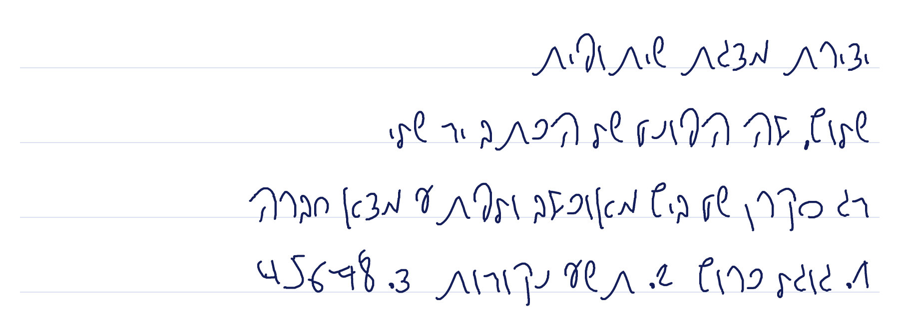

# Tomer Hand — פונט מכתב יד

פונט עברי שנבנה מצילום של דף כתב יד (IMG_3553.HEIC).



## קבצים
- `TomerHand-Regular.ttf` — להתקנה במחשב / טלפון (Windows, macOS, Word, Canva וכו').
- `TomerHand-Regular.woff2` — לשימוש באתרים.
- `glyph-chart.png` — כל התווים בפונט.

## מה יש בפונט
- כל 27 האותיות: א–ת כולל אותיות סופיות (ך ם ן ף ץ).
  - **ף** ו-**ץ** לא הופיעו בדף, ולכן הורכבו מה-פ וה-צ שלך עם זנב יורד.
- ספרות 1–8 (בדף לא היו 0 ו-9).
- סימנים: `. , : * + -` ומקף עברי (־).
- אין אותיות לועזיות. תוכנה שתצטרך אותן תשלים אותן מפונט אחר.

## שימוש באתר
```css
@font-face {
  font-family: "Tomer Hand";
  src: url("TomerHand-Regular.woff2") format("woff2");
}
body { font-family: "Tomer Hand", sans-serif; }
```

## בנייה מחדש
הסקריפטים ב-`tools/` מנקים את השורות של המחברת, חותכים כל אות, מעבירים אותה לשלד ומציירים אותה מחדש בעובי עט אחיד, ואז ממירים לקווי מתאר וקטוריים (potrace) ובונים את הקובץ (fontTools).
```bash
pip install pillow-heif opencv-python-headless scikit-image potracer fonttools brotli
python3 tools/ink.py WORK IMG_3553.HEIC && python3 tools/comps.py WORK
cp tools/spec.json WORK/ && python3 tools/build.py WORK TomerHand-Regular.ttf
```
`spec.json` קובע איזו צורה מהדף משמשת לכל אות. אפשר לשנות אותו כדי לבחור דוגמה אחרת.
